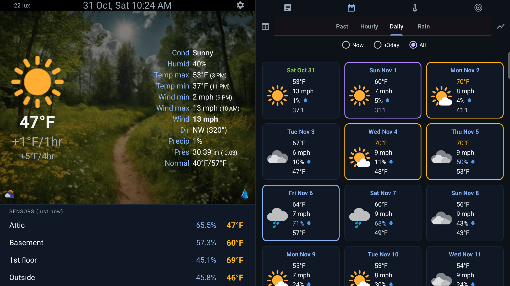
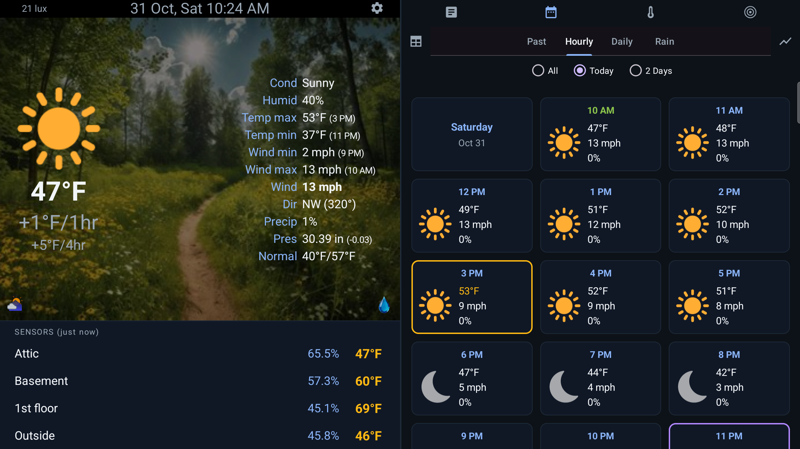
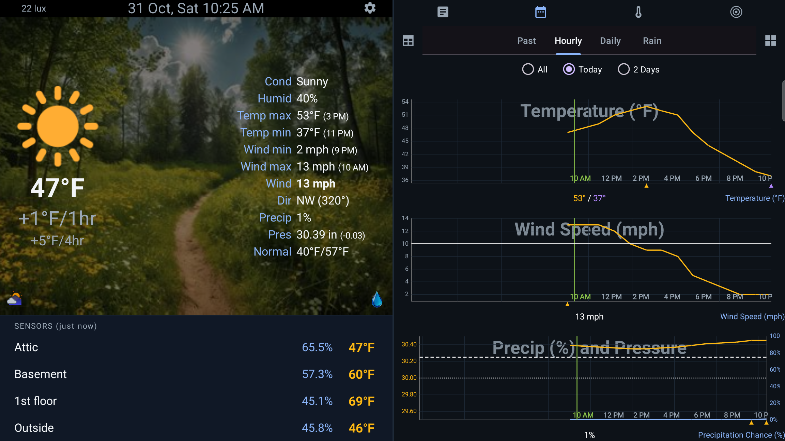
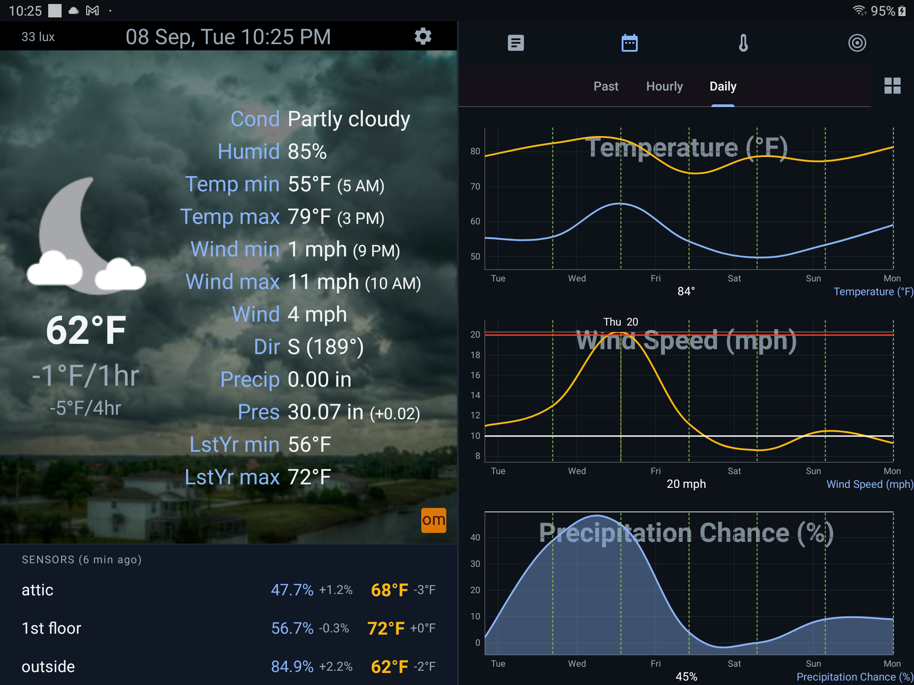
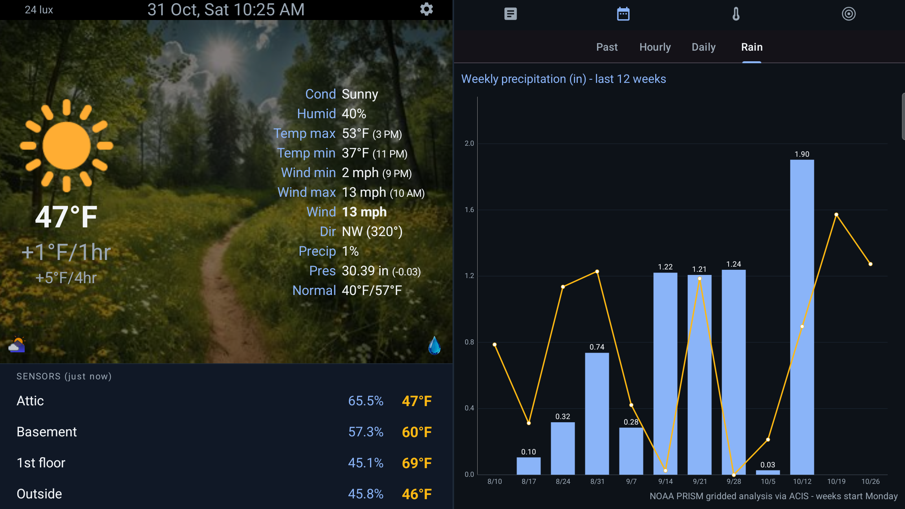
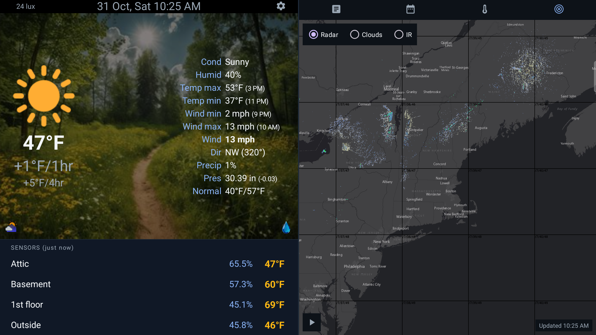
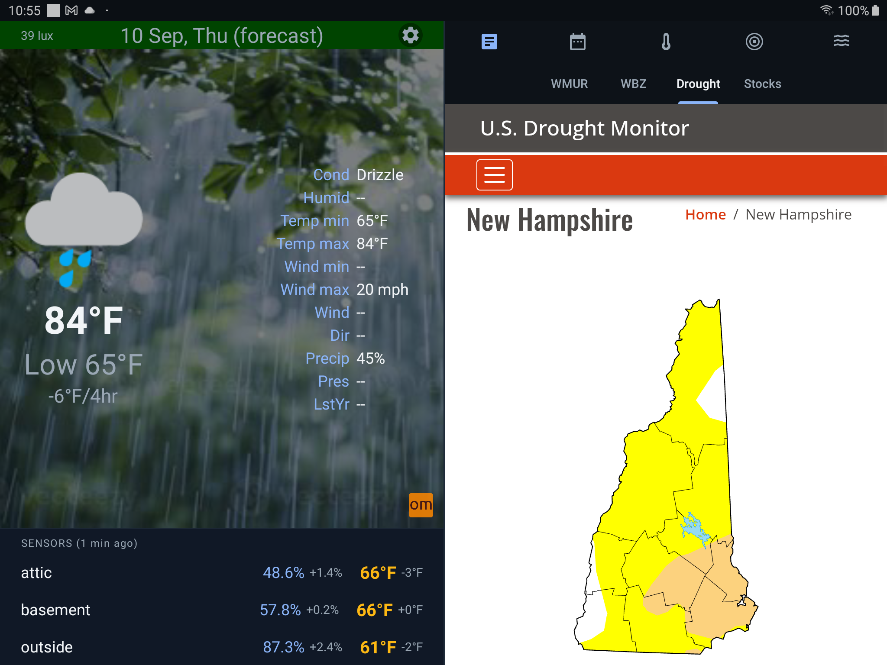
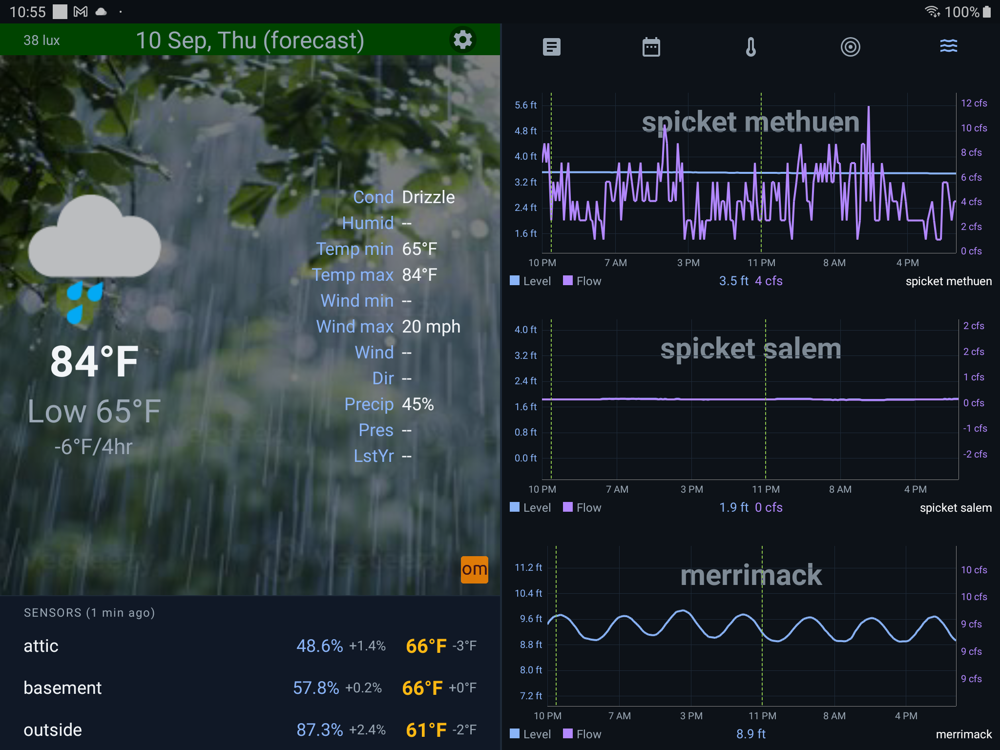
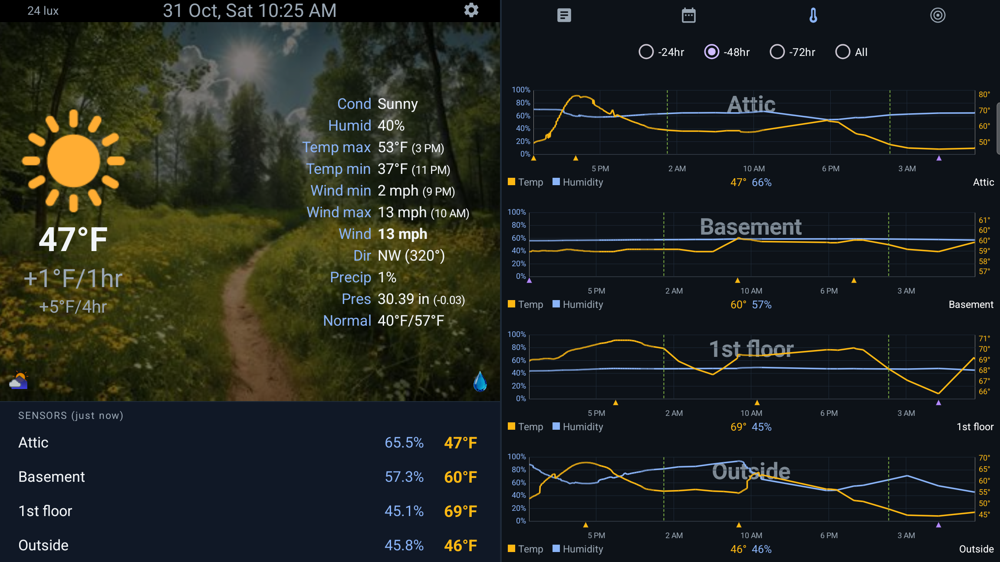
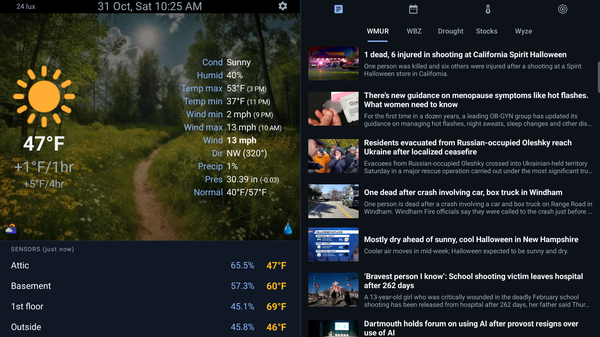

<table border="0">
  <tr>
    <td>
      <!-- VERSION -->v6.10.31<br>
      <!-- DATE -->31-Oct-2026<br>
      Android (Kotlin)<br>
      <a href="https://github.com/landenlabs/all-HomeWx">Repo</a>
    </td>
    <td>
      <a href="https://landenlabs.com">
        
      </a>
    </td>
  </tr>
</table>

# HomeWx

Android (Kotlin) dashboard app for an always-on, wall/shelf-mounted **tablet**.
It shows current outdoor weather on the left and a swipeable info panel on the
right: hourly, daily and past weather (cards, graphs or a table), a rainfall
history, radar and satellite maps, drought monitor, nearby river gauges, RSS
news, and indoor temperature/humidity from Govee sensors. An ambient light
sensor dims the screen at night and brightens it again when the room lights
come back on, so it needs no manual on/off.

**By [LanDen Labs](https://github.com/landenlabs) (2026)**

---

### Screenshots

<table>
  <tr>
    <td><b>Daily forecast</b><br></td>
    <td><b>Hourly forecast</b><br></td>
  </tr>
  <tr>
    <td><b>Hourly graphs</b><br></td>
    <td><b>Daily graphs</b><br></td>
  </tr>
  <tr>
    <td><b>Rain history</b><br></td>
    <td><b>Radar map</b><br></td>
  </tr>
  <tr>
    <td><b>Drought monitor</b><br></td>
    <td><b>River gauges</b><br></td>
  </tr>
  <tr>
    <td><b>Indoor sensors</b><br></td>
    <td><b>News</b><br></td>
  </tr>
</table>

---

### Features

**Weather**
- Current conditions with a background image that follows the weather, daily high/low, and
  1-hour and 4-hour temperature trends.
- Past, Hourly and Daily views, each as cards, graphs (temperature, wind, precipitation,
  pressure) or a table. Tap a Past or Daily card to preview that day on the left.
- Rain tab: weekly precipitation totals for the last 12 weeks.
- Optional notification with current conditions that expands to the next 6 hours.
- Open-Meteo is built in. A second weather source, WxData, appears in Settings once you enter
  its API key, and is hidden until then.

**Maps**
- Animated NEXRAD radar (last 2 hours), GOES satellite clouds and infrared, on a light or dark map.
- **-72h Rain**: radar-estimated rainfall over the past 72 hours.
- **+72h Rain**: NOAA forecast rainfall (QPF) for the next 72 hours. QPF is the forecast
  liquid-equivalent precipitation, not a measurement.
- Switches to the radar automatically while rain is likely and nobody is using the screen.

**Home and local data**
- Indoor temperature and humidity from Govee sensors, with history graphs and optional
  custom room names. A sensor can optionally replace the weather provider's reading.
  Tap the SENSORS title under the weather to collapse or expand the list.
- Nearby USGS river gauges, chosen by ZIP code, with level and flow graphs.
- US Drought Monitor map for the state you pick.
- One or two RSS feeds with thumbnails and an in-panel article viewer, plus a stocks
  widget and an optional Wyze camera tab.

**Always-on behavior**
- The ambient light sensor switches between an active display and a dim night layout.
- Choose what the screen settles on when idle: cycle through News, Weather and Sensor, or
  stay on one panel (and tab). Weather > Hourly and Map > +72h Rain are examples.
- A background service keeps data fresh and restarts after a reboot.
- Export and import your settings and recorded history from Settings.

---

### Requirements

- A tablet running Android 9 (API 28) or newer. The layouts are designed for large screens.
- Internet access. Weather, maps, news and river data are fetched live.

### Setup

Open **Settings** (the gear icon) and use **Accounts & Feeds**:

| Setting | What it does |
|---|---|
| Govee sensors | Your Govee API key, needed for the indoor sensor readings. Leave empty to hide them. |
| Wyze cameras | Your Wyze email and password, used to sign in to the camera tab. Leave empty to hide the tab. |
| WxData weather | Your WxData API key. Without it WxData is hidden from **Weather source** and Open-Meteo is used. |
| News feeds | One or two RSS feed URLs (https) and tab names. **Defaults** restores the built-in feeds. |
| Drought map | The state shown on the Drought tab. Defaults to NH. |

Credentials are stored on the tablet only, encrypted with the Android Keystore, and are
not included in a settings export. Release builds ship with no credentials. Other
Settings sections cover the rivers ZIP code, brightness and the idle panel.

### Building

```
./gradlew assembleDebug
```

Debug builds can pre-fill the Govee and Wyze credentials from `local.properties`
(which is not committed):

```
GOVEE_API_KEY=...
WYZE_USER=...
WYZE_PWD=...
SUN_API_KEY=...   # the WxData key
```

Firebase Analytics and Crashlytics are used only when a `google-services.json` is
present at build time.

---

### Data sources and credits

- [Open-Meteo](https://open-meteo.com) - weather forecasts and history
- [Iowa Environmental Mesonet](https://mesonet.agron.iastate.edu) - NEXRAD radar and the 72-hour rainfall estimate
- [NASA GIBS](https://earthdata.nasa.gov/gibs) - GOES satellite imagery
- [NOAA Weather Prediction Center](https://www.wpc.ncep.noaa.gov) - rainfall forecast (QPF)
- [USGS Water Data](https://waterdata.usgs.gov) - river gauges
- [US Drought Monitor](https://droughtmonitor.unl.edu) - drought maps
- [ACIS / PRISM](https://www.rcc-acis.org) - weekly rainfall history
- [OpenStreetMap](https://www.openstreetmap.org/copyright) contributors and Esri - base maps
- [Govee](https://developer.govee.com) - sensor API
- [TradingView](https://www.tradingview.com) - market overview widget

---

### License

```
Copyright 2026 Dennis Lang (LanDen Labs)

Licensed under the Apache License, Version 2.0 (the "License");
you may not use this file except in compliance with the License.
You may obtain a copy of the License at

 http://www.apache.org/licenses/LICENSE-2.0
Unless required by applicable law or agreed to in writing, software
distributed under the License is distributed on an "AS IS" BASIS,
WITHOUT WARRANTIES OR CONDITIONS OF ANY KIND, either express or implied.
See the License for the specific language governing permissions and
limitations under the License.
```
See [LICENSE](LICENSE) for the full license text.
