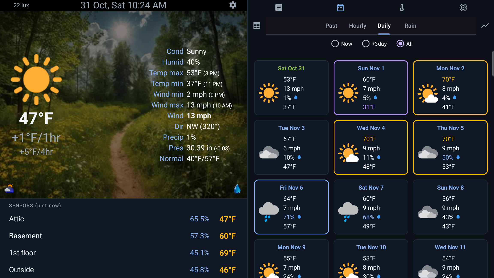
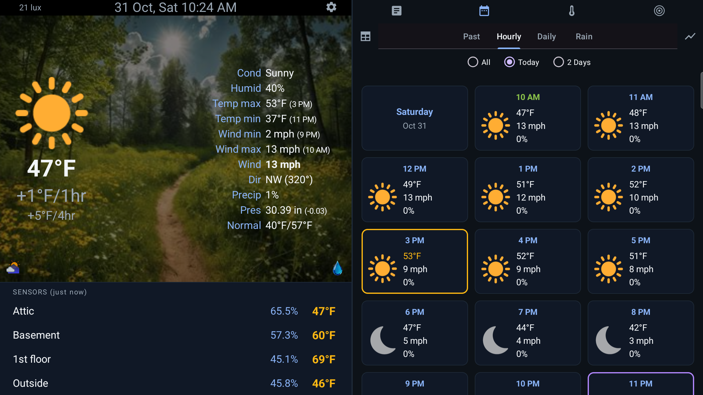
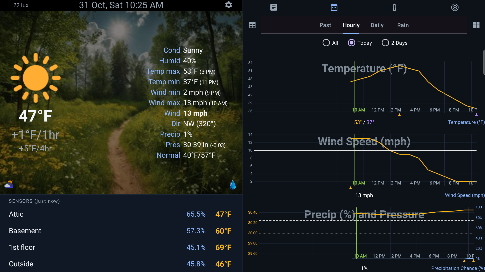
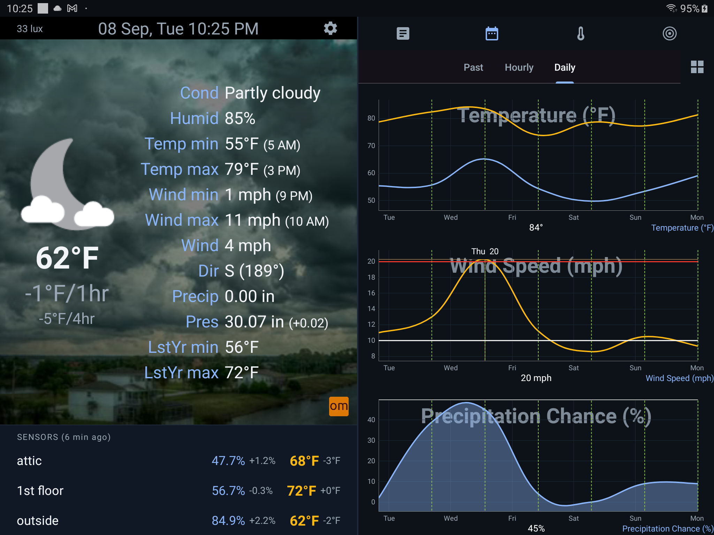
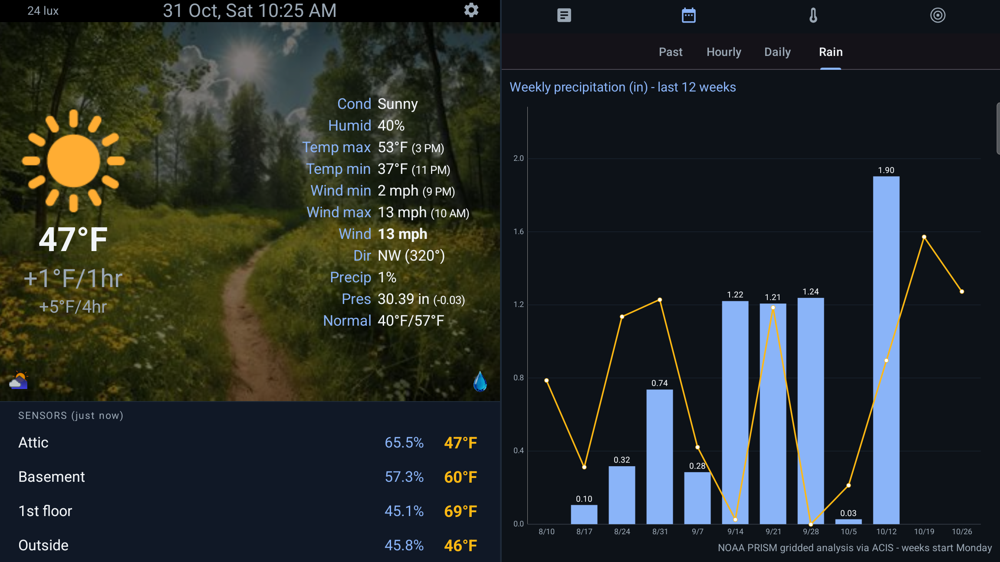
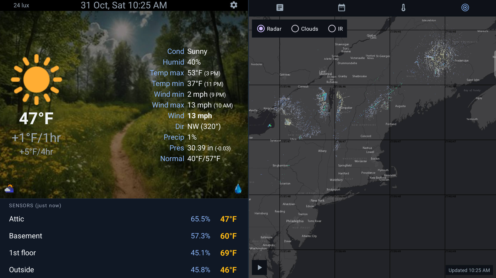
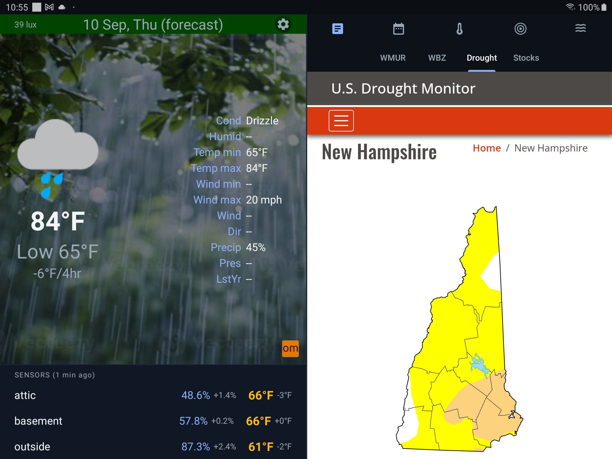
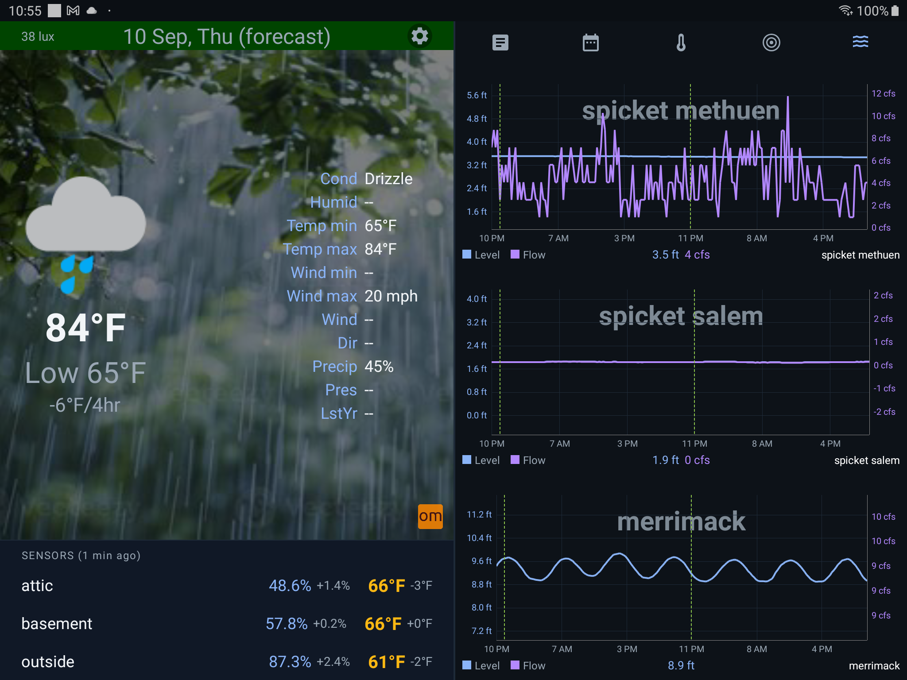
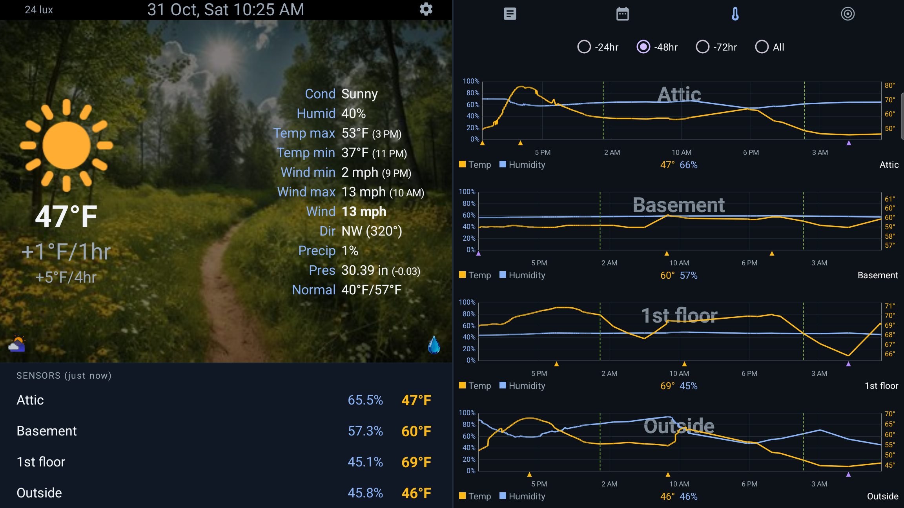
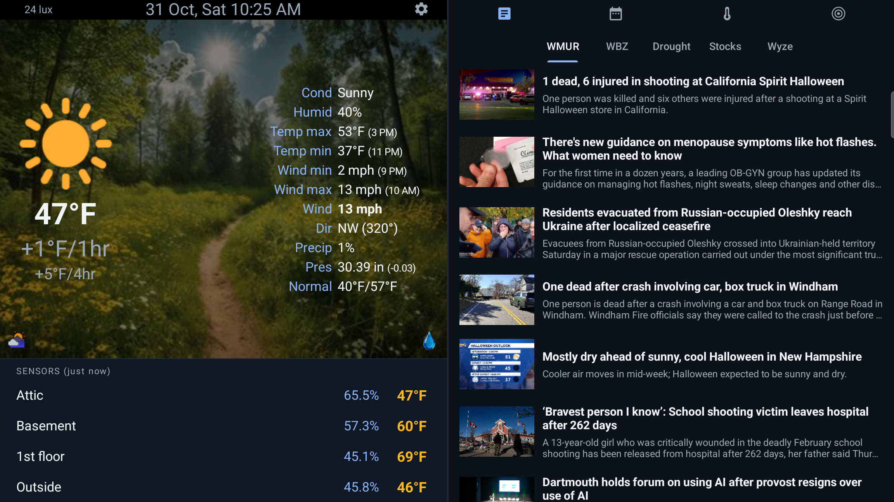

<table border="0">
  <tr>
    <td>
      <!-- VERSION -->v6.11.10<br>
      <!-- DATE -->08-Nov-2026<br>
      Android (Kotlin)<br>
      <a href="https://github.com/landenlabs/all-HomeWx">Repo</a>
    </td>
    <td>
      <a href="https://landenlabs.com">
        
      </a>
    </td>
  </tr>
</table>

# HomeWx

Android (Kotlin) dashboard app for an always-on, wall/shelf-mounted **tablet**.
It shows current outdoor weather on the left and a swipeable info panel on the
right: hourly, daily and past weather (cards, graphs or a table), a rainfall
history, radar and satellite maps, drought monitor, nearby river gauges, RSS
news, and indoor temperature/humidity from Govee sensors. An ambient light
sensor dims the screen at night and brightens it again when the room lights
come back on, so it needs no manual on/off.

**By [LanDen Labs](https://github.com/landenlabs) (2026)**

---

### Screenshots

<table>
  <tr>
    <td><b>Daily forecast</b><br></td>
    <td><b>Hourly forecast</b><br></td>
  </tr>
  <tr>
    <td><b>Hourly graphs</b><br></td>
    <td><b>Daily graphs</b><br></td>
  </tr>
  <tr>
    <td><b>Rain history</b><br></td>
    <td><b>Radar map</b><br></td>
  </tr>
  <tr>
    <td><b>Drought monitor</b><br></td>
    <td><b>River gauges</b><br></td>
  </tr>
  <tr>
    <td><b>Indoor sensors</b><br></td>
    <td><b>News</b><br></td>
  </tr>
</table>

---

### Features

**Weather**
- Current conditions with a background image that follows the weather (clear, cloudy, rainy or
  windy), daily high/low, and 1-hour and 4-hour temperature trends. You can supply your own
  background images, see below.
- Past, Hourly and Daily views, each as cards, graphs (temperature, wind, precipitation,
  pressure) or a table. Tap a Past or Daily card to preview that day on the left.
- Rain tab: weekly precipitation totals for the last 12 weeks.
- Optional notification with current conditions that expands to the next 6 hours.
- Open-Meteo is built in. A second weather source, WxData, appears in Settings once you enter
  its API key, and is hidden until then.

**Maps**
- Animated NEXRAD radar (last 2 hours), GOES satellite clouds and infrared, on a light or dark map.
- **-72h Rain**: radar-estimated rainfall over the past 72 hours.
- **+72h Rain**: NOAA forecast rainfall (QPF) for the next 72 hours. QPF is the forecast
  liquid-equivalent precipitation, not a measurement.
- Switches to the radar automatically while rain is likely and nobody is using the screen.

**Home and local data**
- Indoor temperature and humidity from Govee sensors, with history graphs and optional
  custom room names. A sensor can optionally replace the weather provider's reading.
  Tap the SENSORS title under the weather to collapse or expand the list.
- Nearby USGS river gauges, chosen by ZIP code, with level and flow graphs.
- US Drought Monitor map for the state you pick.
- One or two RSS feeds with thumbnails and an in-panel article viewer, plus a stocks
  widget and an optional Wyze camera tab.

**Always-on behavior**
- The ambient light sensor switches between an active display and a dim night layout.
- Choose what the screen settles on when idle: cycle through News, Weather and Sensor, or
  stay on one panel (and tab). Weather > Hourly and Map > +72h Rain are examples.
- A background service keeps data fresh and restarts after a reboot.
- Export and import your settings and recorded history from Settings.

---

### Requirements

- A tablet running Android 9 (API 28) or newer. The layouts are designed for large screens.
- Internet access. Weather, maps, news and river data are fetched live.

### Setup

Open **Settings** (the gear icon) and use **Accounts & Feeds**:

| Setting | What it does |
|---|---|
| Govee sensors | Your Govee API key, needed for the indoor sensor readings. Leave empty to hide them. |
| Wyze cameras | Your Wyze email and password, used to sign in to the camera tab. Leave empty to hide the tab. |
| WxData weather | Your WxData API key. Without it WxData is hidden from **Weather source** and Open-Meteo is used. |
| News feeds | One or two RSS feed URLs (https) and tab names. **Defaults** restores the built-in feeds. |
| Drought map | The state shown on the Drought tab. Defaults to NH. |

**Your own background images:** in **Settings > Display** choose a folder with **Choose folder...**.
Name files `wx_bg_clear`, `wx_bg_cloudy`, `wx_bg_rainy` or `wx_bg_windy`, optionally followed by
`_` and any text, with a `.jpg`, `.png` or `.webp` extension, for example `wx_bg_clear_001.png`,
`wx_bg_clear_002.jpg` or `wx_bg_clear_bigsky.webp`. Add as many per condition as you like. The
app shows one for the current weather and moves to the next one each hour. A condition with no
matching file uses the built-in image, and **Clear** returns to the built-in images entirely. The
app can read only the folder you choose, and the status line under the button shows how many
matching files it found.

Credentials are stored on the tablet only, encrypted with the Android Keystore, and are
not included in a settings export. Release builds ship with no credentials. Other
Settings sections cover the rivers ZIP code, brightness and the idle panel.

### Building

```
./gradlew assembleStandardDebug   # default: Open-Meteo only, no wxdata AAR
./gradlew assembleWxdataDebug     # adds the wxdata AAR and its Settings options
```

The `standard` flavor (the default) leaves out the wxdata library: Settings has no WxData
key entry and WxData is never offered as a weather source. The `wxdata` flavor needs
`app/libs/wxdata-*.aar`.

Debug builds can pre-fill the Govee and Wyze credentials from `local.properties`
(which is not committed):

```
GOVEE_API_KEY=...
WYZE_USER=...
WYZE_PWD=...
SUN_API_KEY=...   # the WxData key
```

Firebase Analytics and Crashlytics are used only when a `google-services.json` is
present at build time.

---

### Privacy

The same information is shown in the app under **Settings > Privacy**. HomeWx has no
account, no ads and no advertising ID (the AD_ID permission is removed from the manifest),
does not ask for location permission, and does not sell or share data with anyone for
marketing.

| # | Data | Required? | Where it is kept | Who receives it, and why |
|---|---|---|---|---|
| 1 | **Location: home ZIP code** and its center point (latitude/longitude) | Optional (defaults to a built-in location) | On the tablet, in app settings | The ZIP is sent to `api.zippopotam.us` once, to look up its center point. That center point is sent to the weather, rain and river services (Open-Meteo, WxData / weather.com, ACIS, Iowa Mesonet, USGS) to fetch data for your area, including river gauges and rain totals, and marks "home" on the radar map. The device's own GPS position is never read. |
| 2 | **Wyze email and password** | Optional | On the tablet only, encrypted with the Android Keystore | Entered by the app into the Wyze sign-in page (`auth.wyze.com`) to open your camera page. Not sent anywhere else. |
| 3 | **Govee API key** | Optional | On the tablet only, encrypted with the Android Keystore | Sent to Govee's API (`openapi.api.govee.com`) to read your sensors. Not sent anywhere else. |
| 4 | **WxData API key** (wxdata build only) | Optional | On the tablet only, encrypted with the Android Keystore | Sent to `api.weather.com` to fetch weather. Not sent anywhere else. |
| 5 | **Sensor, weather, river and rain history** | Automatic | On the tablet only, in a local database | Not sent anywhere. **Export** in Settings writes it to a file you choose; credentials are never included. |
| 6 | **Usage analytics** (Firebase Analytics) | On by default, when Firebase is built in; can be turned off | Google Cloud (Firebase) | Anonymous usage counts and device info (model, OS version, app version, country), tied to a random app-instance ID. Managed by Google under its privacy policy. |
| 7 | **Crash and error reports** (Firebase Crashlytics) | On by default, when Firebase is built in; can be turned off | Google Cloud (Firebase) | Crash stack traces and handled errors with device info. An error message can include a Govee device name or a server's error text. Managed by Google. |
| 8 | **Error log** (Settings > Errors) | Automatic | On the tablet only, in memory. It keeps the last 5 errors and is cleared when the app restarts or you tap **Clear** | Not sent anywhere unless you tap **Share**, which opens Android's share sheet so you pick the app and the recipient. Each entry has the time, which feature failed, the error message and the technical details (stack trace). These can include a Govee device name, a news feed name or a server's error text, but never credentials. |
| 9 | **News, map and web pages** | Automatic | Pages and images cached on the tablet | Loading RSS feeds, articles, map tiles, the TradingView widget and the drought map makes requests to those sites, which see your IP address and may set cookies in the app's web view. |
| 10 | **Android Auto Backup** | Automatic, if backup is on for the tablet | Your Google Drive backup | Android may back up app settings (including the ZIP code) to your Google account. Encrypted credentials can't be decrypted after a restore, because the Keystore key is not backed up. |

Google deletes crash reports after 90 days and analytics data after 2 months (Firebase defaults).

**Opting out:** items 1 to 4 can be cleared in **Settings** (leave the field empty, or
**Clear**), and item 8 with **Clear** in **Settings > Errors**. Turn off **Settings > Privacy > Send anonymous usage stats and crash reports** to
stop Firebase reporting; this also discards crash reports not yet sent and resets the
analytics ID. Data already sent can't be deleted from the app and expires as above. Builds
without a `google-services.json` contain no Firebase reporting at all. Uninstalling the app
deletes everything it stored on the tablet.

#### Permissions

| Permission | Why |
|---|---|
| Internet, network state | Fetch weather, maps, news and river data, and detect when the network is down. |
| Foreground service (`dataSync`) and notifications | Keeps sensor, weather, news and river updates running while the dashboard is on, shown by an ongoing "All HomeWx is watching your home" notification. Updates slow down when the room is dark. On Android 15+ the service stops after Android's 6-hour background limit and restarts when the app is opened again. |
| Wake lock, Play install referrer | Added by Firebase Analytics, to send reports and record how the app was installed. The app keeps the screen on with a window setting that needs no permission. |
| Run at startup | Reopens the dashboard after the tablet restarts. |

The app does not ask for location, camera, microphone, contacts, photos or storage permission.
A background-image folder is read only if you pick one in Settings.

---

### Data sources and credits

- [Open-Meteo](https://open-meteo.com) - weather forecasts and history
- [Iowa Environmental Mesonet](https://mesonet.agron.iastate.edu) - NEXRAD radar and the 72-hour rainfall estimate
- [NASA GIBS](https://earthdata.nasa.gov/gibs) - GOES satellite imagery
- [NOAA Weather Prediction Center](https://www.wpc.ncep.noaa.gov) - rainfall forecast (QPF)
- [USGS Water Data](https://waterdata.usgs.gov) - river gauges
- [US Drought Monitor](https://droughtmonitor.unl.edu) - drought maps
- [ACIS / PRISM](https://www.rcc-acis.org) - weekly rainfall history
- [OpenStreetMap](https://www.openstreetmap.org/copyright) contributors and Esri - base maps
- [Govee](https://developer.govee.com) - sensor API
- [TradingView](https://www.tradingview.com) - market overview widget

---

### License

```
Copyright 2026 Dennis Lang (LanDen Labs)

Licensed under the Apache License, Version 2.0 (the "License");
you may not use this file except in compliance with the License.
You may obtain a copy of the License at

 http://www.apache.org/licenses/LICENSE-2.0
Unless required by applicable law or agreed to in writing, software
distributed under the License is distributed on an "AS IS" BASIS,
WITHOUT WARRANTIES OR CONDITIONS OF ANY KIND, either express or implied.
See the License for the specific language governing permissions and
limitations under the License.
```
See [LICENSE](LICENSE) for the full license text.
